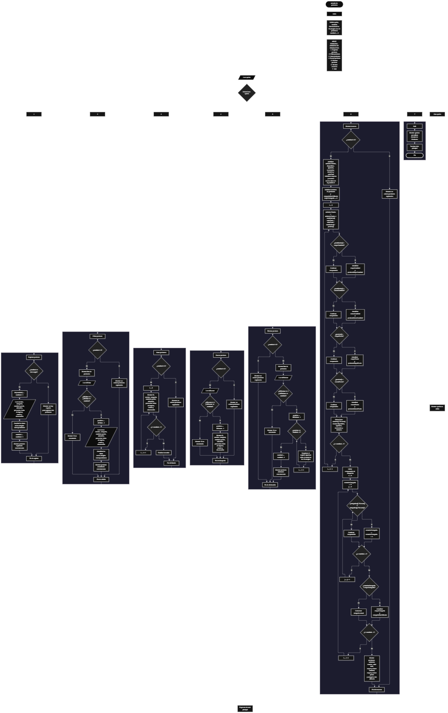

Este proyecto, llamado <b>armario de productos</b>, fue desarrollado en <b>visual basic .net</b> como un ejercicio práctico para fortalecer la lógica de programación mediante la creación de un sistema de gestión de inventario desde la consola. El programa cuenta con un menú principal de siete opciones que permite <b>registrar, editar, listar, buscar, eliminar productos y consultar un resumen general</b> del inventario. Cada producto almacena información como el nombre, la categoría, la cantidad, el precio, la ubicación, el proveedor, la fecha de ingreso, el estado y las observaciones, utilizando arreglos con una capacidad máxima de <b>10 productos durante la ejecución</b>. Durante su desarrollo se aplicaron conceptos fundamentales de programación, como variables, arreglos, estructuras condicionales, ciclos repetitivos y estructuras de selección, además de procesos para gestionar registros, reorganizar información y calcular estadísticas. Este proyecto permite poner en práctica los conocimientos adquiridos en Visual Basic .NET y sirve como base para desarrollar sistemas de gestión de inventarios más avanzados.

<h2 align="center">⚙️ Funcionamiento del menú principal</h2>

### ➕ Registrar producto

La opción <b>1) registrar producto</b> permite almacenar un nuevo producto en el inventario. Antes de realizar el registro, el sistema comprueba que la cantidad de productos almacenados sea menor que la capacidad máxima del arreglo <b>ids</b>, utilizando la condición <b>cantidad &gt;= ids.Length</b>. Si el inventario todavía dispone de espacio, el programa genera un identificador mediante la expresión <b>cantidad + 1</b> y solicita los datos correspondientes al producto: <b>nombre, categoría, cantidad, precio, ubicación, proveedor, fecha de ingreso, estado y observación</b>. Toda esta información se almacena en la posición correspondiente de sus respectivos arreglos. Finalmente, aumenta la variable <b>cantidad</b> en uno y muestra el mensaje <b>"producto registrado correctamente."</b>. Si se alcanza la capacidad máxima de 10 productos, presenta el mensaje <b>"no hay espacio para registrar más productos."</b>, impidiendo agregar nuevos registros.

### ✏️ Editar producto

La opción <b>2) editar producto</b> permite modificar la información de un producto registrado. Primero, el programa comprueba si existen productos almacenados mediante la variable <b>cantidad</b>. Si no hay registros, muestra el mensaje <b>"no existen productos registrados."</b>. En caso contrario, presenta una lista con todos los datos de los productos disponibles. Después, solicita el ID del producto que se desea editar y comprueba que se encuentre dentro del rango permitido mediante la condición <b>idEditar &gt;= 1 And idEditar &lt;= cantidad</b>. Si el identificador es válido, calcula su posición utilizando la expresión <b>idEditar - 1</b>. A continuación, solicita los nuevos datos del producto: nombre, categoría, cantidad, precio, ubicación, proveedor, fecha de ingreso, estado y observación, actualizando directamente los valores de los arreglos correspondientes. Finalmente, muestra el mensaje <b>"producto actualizado correctamente."</b>. Si el ID introducido no corresponde al rango permitido, presenta el mensaje <b>"ID no encontrada."</b>.

### 📋 Listar productos

La opción <b>3) listar productos</b> permite visualizar todos los productos registrados actualmente en el inventario. Antes de mostrar la información, el programa comprueba si la variable <b>cantidad</b> es igual a cero. Si no existen registros, presenta el mensaje <b>"no existen productos registrados."</b>. Si hay productos disponibles, utiliza un ciclo <b>For</b> para recorrer los arreglos desde la posición inicial hasta la última posición ocupada. Durante el recorrido, muestra el ID, nombre, categoría, cantidad, precio, ubicación, proveedor, fecha de ingreso, estado y observación de cada producto. Esta función facilita consultar los registros existentes sin necesidad de buscar cada producto individualmente.

### 🔎 Buscar producto

La opción <b>4) buscar producto</b> permite localizar un producto mediante su identificador. Primero, el programa comprueba si existen productos registrados. Si el inventario está vacío, muestra el mensaje <b>"no existen productos registrados."</b>. En caso contrario, solicita el ID del producto que se desea buscar y comprueba que esté dentro del rango permitido mediante la condición <b>idBuscar &gt;= 1 And idBuscar &lt;= cantidad</b>. Si la selección es válida, obtiene la posición del producto utilizando la expresión <b>idBuscar - 1</b> y muestra toda su información: <b>ID, nombre, categoría, cantidad, precio, ubicación, proveedor, fecha de ingreso, estado y observación</b>. Si el identificador no corresponde al rango permitido, presenta el mensaje <b>"ID no encontrada."</b>.

### 🗑️ Eliminar producto

La opción <b>5) eliminar producto</b> permite eliminar un producto registrado mediante su identificador. Antes de comenzar, el programa comprueba que existan productos almacenados. Si el inventario está vacío, muestra el mensaje <b>"no existen productos registrados."</b>. Si hay registros disponibles, presenta una lista con todos los datos de los productos. Después, solicita el ID del producto que se desea eliminar y verifica que esté dentro del rango permitido. Si el identificador es válido, calcula su posición mediante la expresión <b>idEliminar - 1</b> y comienza el proceso de eliminación. Para mantener los registros organizados, utiliza un ciclo <b>For</b> controlado por la variable <b>i</b>, que desplaza una posición hacia la izquierda los datos de los productos posteriores en los diez arreglos: <b>ids, nombres, categorias, cantidades, precios, ubicaciones, proveedores, fechasIngreso, estados y observaciones</b>. Posteriormente, disminuye la variable <b>cantidad</b> en uno y muestra el mensaje <b>"producto eliminado correctamente."</b>. Si el identificador introducido no corresponde al rango permitido, presenta el mensaje <b>"ID no encontrada."</b>.

### 📊 Mostrar resumen

La opción <b>6) mostrar resumen</b> permite consultar estadísticas generales del inventario a partir de los productos registrados. Primero, el programa comprueba si existen registros almacenados. Si el inventario está vacío, muestra el mensaje <b>"no existen productos registrados."</b>. En caso contrario, inicializa diferentes contadores y acumuladores para calcular las estadísticas. Mediante un ciclo <b>For</b>, recorre los productos y obtiene las <b>unidades totales</b>, el <b>valor económico total del inventario</b> y los productos con la mayor y menor cantidad, así como los productos con el mayor y menor precio. También utiliza una estructura <b>Select Case</b> para contar los productos según sus estados: <b>disponible, agotado, reservado y dañado</b>. Para identificar la categoría más utilizada, implementa dos ciclos <b>For</b> anidados que comparan las categorías almacenadas y cuentan sus coincidencias sin distinguir entre mayúsculas y minúsculas mediante <b>ToLower()</b>. Finalmente, muestra la cantidad de productos, las unidades totales, los diferentes estados, el valor total, los productos con mayor y menor cantidad, los productos con mayor y menor precio y la categoría más utilizada.

### 🚪 Salir del menú principal

La opción <b>7) salir</b> está destinada a finalizar la ejecución del programa y muestra el mensaje <b>"gracias por utilizar armario de productos."</b>. El menú principal se encuentra dentro de una estructura repetitiva <b>Do...Loop While</b>, que mantiene el programa en funcionamiento mientras la variable <b>opcion</b> sea diferente de <b>7</b>. Cuando el usuario selecciona esta opción, el ciclo termina y el programa finaliza su ejecución.

<h2 align="center">🧠 Temas aplicados en el proyecto</h2>

### 📦 Variables

En este proyecto se utilizan variables para almacenar la opción seleccionada en el menú, controlar la cantidad de productos registrados, identificar las posiciones de los arreglos, seleccionar los productos que se desean editar, buscar o eliminar y calcular las estadísticas generales del inventario. También se utilizan variables auxiliares para acumular cantidades, contar los estados de los productos, comparar precios y cantidades e identificar la categoría más utilizada. Cada variable cumple una función específica dentro de las operaciones de gestión y análisis de los productos.

🔢 **Opcion:** Almacena la opción seleccionada por el usuario en el menú principal.

📊 **Cantidad:** Controla el número actual de productos registrados.

🔄 **I:** Funciona como contador en los ciclos `For` y permite recorrer los arreglos, además de controlar el desplazamiento de registros durante la eliminación.

🔁 **J:** Funciona como contador del ciclo interno utilizado para comparar las categorías de los productos.

✏️ **IdEditar:** Almacena el identificador del producto que se desea modificar.

🔎 **IdBuscar:** Almacena el identificador del producto que se desea consultar.

🗑️ **IdEliminar:** Almacena el identificador del producto que se desea eliminar.

📍 **Posicion:** Permite determinar la posición del producto seleccionado dentro de los arreglos mediante la operación de restar uno al ID.

📦 **UnidadesTotales:** Acumula la cantidad total de unidades almacenadas en el inventario.

💰 **ValorTotal:** Acumula el valor económico de todos los productos mediante la multiplicación de sus cantidades por sus precios.

📊 **Disponibles, Agotados, Reservados y Danados:** Almacenan la cantidad de productos que pertenecen a cada estado.

📈 **MayorCantidad y MenorCantidad:** Guardan los valores máximos y mínimos de las cantidades registradas.

💵 **MayorPrecio y MenorPrecio:** Guardan los precios más altos y más bajos del inventario.

🏷️ **ProductoMayorCantidad, ProductoMenorCantidad, ProductoMayorPrecio y ProductoMenorPrecio:** Almacenan los nombres de los productos que presentan los valores máximos y mínimos correspondientes.

📂 **CategoriaMasUtilizada:** Almacena el nombre de la categoría que presenta la mayor frecuencia entre los productos registrados.

🔢 **MayorCategoria:** Almacena la frecuencia más alta encontrada durante la comparación de las categorías.

🔄 **ContadorCategoria:** Cuenta cuántas veces aparece una categoría determinada durante las comparaciones realizadas por los ciclos anidados.

### 🗃️ Arreglos

En este proyecto se utilizan diez arreglos relacionados con la información de cada producto. Cada arreglo tiene una capacidad de <b>10 posiciones</b> y utiliza el mismo índice para representar los datos correspondientes a un mismo registro. Por ejemplo, la información de un producto almacenado en la posición <b>0</b> se encuentra distribuida entre <b>ids[0], nombres[0], categorias[0], cantidades[0], precios[0], ubicaciones[0], proveedores[0], fechasIngreso[0], estados[0] y observaciones[0]</b>. Esta organización permite recorrer, consultar, modificar, eliminar y analizar los productos de manera ordenada.

🆔 **Ids[10]:** Almacena los identificadores de los productos registrados.

📝 **Nombres[10]:** Almacena los nombres de los productos.

🏷️ **Categorias[10]:** Almacena las categorías a las que pertenecen los productos.

📦 **Cantidades[10]:** Almacena las unidades registradas de cada producto.

💰 **Precios[10]:** Almacena los precios individuales de los productos.

📍 **Ubicaciones[10]:** Almacena los lugares donde se encuentran los productos.

🏭 **Proveedores[10]:** Almacena los nombres de los proveedores.

📅 **FechasIngreso[10]:** Almacena las fechas de ingreso de los productos.

📊 **Estados[10]:** Almacena el estado actual de cada producto.

📄 **Observaciones[10]:** Almacena información adicional sobre los productos.

### 🔀 Estructuras condicionales

En este proyecto se utilizan las estructuras <b>If...Else</b> para comprobar si el inventario dispone de espacio antes de registrar un producto, verificar si existen registros antes de ejecutar determinadas operaciones y validar que el ID seleccionado se encuentre dentro del rango permitido. También se utilizan para comparar las cantidades y los precios de los productos, identificando los valores mayores y menores durante el cálculo del resumen. Estas condiciones permiten que el programa responda de manera diferente según la información almacenada y el resultado de cada operación.

### 🔄 Estructuras repetitivas

En este proyecto se utilizan los ciclos <b>Do...Loop While</b> y <b>For</b>. El ciclo <b>Do...Loop While</b> mantiene activo el menú principal mientras el usuario no seleccione la opción 7. Por otro lado, los ciclos <b>For</b> permiten recorrer los arreglos para mostrar los productos, consultar sus datos y realizar el desplazamiento de registros durante la eliminación. También se utilizan para recorrer los productos durante el cálculo de estadísticas y, mediante ciclos anidados, comparar las categorías para determinar cuál es la más utilizada.

### 🎯 Estructura según

El programa utiliza la estructura <b>Select Case</b> para evaluar el valor almacenado en la variable <b>opcion</b> y ejecutar el bloque de instrucciones correspondiente a cada alternativa del menú principal. Cada caso representa una operación específica del sistema: <b>registrar, editar, listar, buscar, eliminar, mostrar resumen o salir</b>. También se utiliza el bloque <b>Case Else</b> para mostrar el mensaje <b>"opcion no valida."</b> cuando el usuario introduce un número que no coincide con ninguna de las opciones definidas.

Además, dentro del resumen estadístico se utiliza otra estructura <b>Select Case</b> para clasificar los productos según su estado. Esta estructura permite contar los productos disponibles, agotados, reservados y dañados, reconociendo las variantes <b>"dañado"</b> y <b>"danado"</b> mediante la comparación de los textos convertidos a minúsculas.

### 🔢 Dimensionamiento de arreglos

El programa utiliza la declaración de arreglos para establecer la capacidad de almacenamiento de los productos. Se definieron <b>10 posiciones</b> para cada uno de los diez arreglos, utilizando índices comprendidos entre <b>0 y 9</b>. La cantidad de posiciones ocupadas se controla mediante la variable <b>cantidad</b>, por lo que las operaciones recorren únicamente los registros comprendidos entre la primera posición y el total actual de productos. Además, se utiliza la propiedad <b>Length</b> del arreglo <b>ids</b> para comprobar su capacidad máxima antes de realizar un nuevo registro.

### 🔄 Reorganización de registros

Cuando se selecciona un producto para eliminarlo, el programa utiliza un ciclo <b>For</b> que comienza en la posición seleccionada y llega hasta <b>cantidad - 2</b>. En cada repetición, los datos de la posición siguiente se copian sobre la posición actual en los diez arreglos: <b>ids, nombres, categorias, cantidades, precios, ubicaciones, proveedores, fechasIngreso, estados y observaciones</b>. Después, la variable <b>cantidad</b> disminuye en uno. De esta manera, los productos posteriores ocupan las posiciones disponibles y los registros activos permanecen agrupados al inicio de los arreglos. Los identificadores se desplazan junto con los demás datos, pero no se renumeran.

### 📊 Cálculo de estadísticas

El proyecto incorpora operaciones de análisis para obtener información general del inventario. Utiliza acumuladores para sumar las unidades y calcular el valor económico total, contadores para clasificar los productos según su estado y comparaciones condicionales para identificar las cantidades y los precios máximos y mínimos. También utiliza ciclos anidados para calcular la frecuencia de aparición de cada categoría. Estas operaciones permiten obtener una visión general de la composición y distribución de los productos registrados.

<h2 align="center">¿Cómo se implementaron las operaciones crud en el proyecto?</h2>

Las operaciones <b>crud</b> se implementaron mediante las opciones del menú principal, permitiendo administrar los productos registrados. La operación <b>crear</b> corresponde a <b>registrar producto</b>, donde se introducen los datos de un nuevo elemento del inventario; <b>leer</b> se realiza mediante las opciones <b>buscar producto y listar productos</b>, que permiten consultar uno o todos los registros; <b>actualizar</b> corresponde a <b>editar producto</b>, donde se modifican los datos de un producto existente; y <b>eliminar</b> se realiza mediante la opción <b>eliminar producto</b>, que retira un registro y reorganiza los datos de los arreglos. Además, el sistema incorpora la opción <b>mostrar resumen</b>, que permite analizar la información almacenada mediante diferentes estadísticas. Todas estas operaciones utilizan variables, arreglos, condicionales y ciclos para gestionar la información temporalmente durante la ejecución del programa.

<h2 align="center">Diagrama de flujo del proyecto</h2>

<h2 align="center">🛡️ Validaciones del programa</h2>

### 📭 No existen productos registrados

Esta validación se utiliza en las opciones de <b>editar, listar, buscar, eliminar y mostrar resumen</b>. El programa comprueba si la variable <b>cantidad</b> es igual a <b>0</b> y, si no existen productos registrados, muestra el mensaje <b>"no existen productos registrados."</b>. Esta comprobación evita continuar con las operaciones que necesitan información almacenada cuando el inventario está vacío.

### ⚠️ Capacidad máxima del inventario

Esta validación se utiliza durante el registro de nuevos productos para controlar la capacidad máxima de los arreglos. El programa comprueba si <b>cantidad &gt;= ids.Length</b> antes de permitir agregar un nuevo registro. Si existe espacio disponible, solicita los datos del producto y aumenta el contador. En caso contrario, muestra el mensaje <b>"no hay espacio para registrar más productos."</b>, impidiendo superar la capacidad de 10 productos.

### 🔢 Selección de productos mediante ID

El programa utiliza los identificadores para seleccionar los productos que se desean editar, buscar o eliminar. Antes de realizar estas operaciones, comprueba que el ID introducido sea mayor o igual a <b>1</b> y menor o igual al valor de <b>cantidad</b>. Si la selección se encuentra dentro del rango permitido, calcula la posición del producto mediante la expresión <b>ID - 1</b>. Si el identificador está fuera de ese rango, muestra el mensaje <b>"ID no encontrada."</b>. Esta comprobación controla el acceso a las posiciones utilizadas de los arreglos.

### 🔄 Reorganización después de eliminar

Durante la eliminación de un producto, el programa desplaza los datos de los registros posteriores una posición hacia la izquierda y disminuye la variable <b>cantidad</b> en uno. Sin embargo, los identificadores no se renumeran después de este procedimiento. Como las operaciones de edición, búsqueda y eliminación calculan la posición utilizando <b>ID - 1</b>, esta situación puede provocar que un identificador deje de corresponder con la posición real del producto después de eliminar un registro intermedio. Además, la generación de nuevos identificadores mediante <b>cantidad + 1</b> puede producir identificadores repetidos.

### 📊 Clasificación de estados

Durante el cálculo del resumen, el programa utiliza la estructura <b>Select Case</b> para reconocer los estados <b>"disponible", "agotado", "reservado" y "dañado"</b>. También acepta la variante escrita sin tilde <b>"danado"</b>. Para realizar estas comparaciones, convierte el contenido del arreglo <b>estados</b> a minúsculas mediante <b>ToLower()</b>. Los estados que no coinciden con ninguna de las alternativas definidas no se incluyen en los contadores del resumen.

### 🏷️ Comparación de categorías

El programa utiliza dos ciclos <b>For</b> anidados para comparar las categorías de los productos y calcular cuántas veces aparece cada una. Mediante la expresión <b>categorias(i).ToLower() = categorias(j).ToLower()</b>, realiza las comparaciones sin distinguir entre mayúsculas y minúsculas. Cuando encuentra una categoría con una frecuencia superior a la almacenada en <b>mayorCategoria</b>, actualiza el contador máximo y guarda su nombre en <b>categoriaMasUtilizada</b>. Si varias categorías tienen la misma frecuencia máxima, conserva la primera que alcanza ese valor.

### ⚠️ Validación de datos numéricos

El programa utiliza las instrucciones <b>Convert.ToInt32()</b> y <b>Convert.ToDouble()</b> para convertir los datos introducidos por el usuario en valores numéricos. Estas conversiones permiten almacenar las cantidades como números enteros y los precios como números decimales. Sin embargo, el código actual no incorpora un control de excepciones para evitar errores cuando se introducen valores que no pueden convertirse a los tipos numéricos solicitados.

### ❌ Opción inválida

La estructura <b>Select Case</b> incluye el bloque <b>Case Else</b>, que muestra el mensaje <b>"opcion no valida."</b> cuando el usuario introduce un número que no corresponde a ninguna de las opciones definidas en el menú principal. Esta alternativa permite informar al usuario cuando selecciona una opción no disponible.

<h2 align="center">🎯 Objetivo del proyecto</h2>

El objetivo principal de este proyecto es fortalecer la <b>lógica de programación</b> mediante el desarrollo de un sistema de gestión de inventario en <b>visual basic .net</b>. A través de su construcción se busca aplicar los conocimientos adquiridos sobre variables, arreglos, estructuras condicionales, ciclos repetitivos y estructuras de selección, integrándolos para resolver un problema de administración de productos de manera organizada. Además, el proyecto permite comprender cómo registrar, consultar, modificar y eliminar información, así como realizar cálculos y comparaciones para obtener estadísticas generales de un inventario, estableciendo una base para desarrollar sistemas de gestión más completos con otros lenguajes y tecnologías.

